<div align="center">


# MatIdentity

**One sign-in for all your Mat apps.**

The OpenID Connect server of the Mat family: people sign in once, here, and every app (MatSplit, MatPaper, MatMail, Mattiverse, …)
lets them in. Apps that talk to each other get their tokens here too. Self-hosted, one container, one volume.

</div>

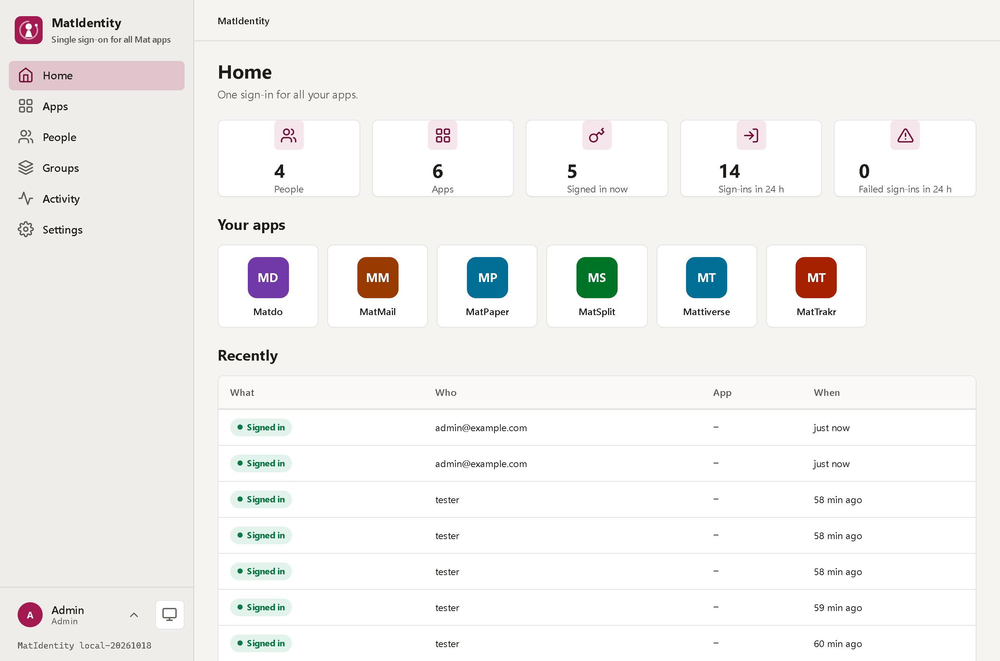

---

## What this is about

Every Mat app has its own users and its own sign-in form. MatIdentity is the optional shared one: set
`MATIDENTITY_AUTHORITY` (and the client id and secret) in an app, and a person who is not signed in goes straight here and comes back
signed in, **without a second form** in any other app. Without the variable an app works exactly as before.
The contract every app follows is [docs/PLATFORM.md of MatDesign](https://github.com/Real-TTX/MatDesign/blob/main/docs/PLATFORM.md).

## At a glance

**Sign-in**
- **OpenID Connect** with authorization code and **PKCE** (enforced), refresh tokens, sign-out at every app (end session)
- **Single sign-on**: a session here signs a person into the next app without the form
- Sessions live in SQLite and **survive a restart**; a person sees their devices and signs out the others
- The tokens carry `sub` (a stable UUID), `name`, `preferred_username`, `email` and the `role` **of the app** (see Permissions)

**Second step (optional for everyone)**
- **Authenticator app** (TOTP, RFC 6238) with a QR code and 10 **recovery codes**, shown once
- **Passkeys** (WebAuthn: Windows Hello, Touch ID, phone, security key): sign in **without a password**, or use one as the second step after it
- Whoever has an authenticator app or a passkey is asked for it after the password; five wrong codes and it starts again
- An administrator sees who uses what and resets it when a phone is lost

**Permissions**
- **Groups** (Family, Guests): apps and roles for many people at once
- **Who may sign in** to an app: a new app is open to nobody but the administrators until people or groups are given to it (or it is opened to everyone)
- **Who decides the roles**, per app: *Admin* (MatIdentity gives each person or group a role of the app, the token carries it) or *Managed by the app* (no role in the token, the app decides)
- The roles of an app come from its MatApiDefinition (`roles`) or are written down; the rules are asked at every sign-in and every renewal
- **Which apps an app may call** (machine tokens): all, or the ones chosen

**Apps**
- Add an app in the UI, or let **Mattiverse** add it when it installs one (`/api/v1/clients`, marked *Managed by mattiverse*)
- The **secret is shown once** with the variables the app needs, ready to copy; MatIdentity keeps only its hash
- **Apps calling apps**: an app with *calls other apps* gets a token for `app:<id>` (client credentials) whose audience is the other app

**Administration**
- **People**: create, change, disable; a disabled account or a new password signs the person out **everywhere** (sessions and the refresh tokens of the apps)
- **Activity**: sign-ins, failed sign-ins (a badge in the menu), app sign-ins, machine tokens, changes to apps; kept for 90 days
- **Sign everyone out**: the emergency button
- Rate limits on the sign-in form, the token endpoint and the API; forwarded headers only from known proxies

**The Mat platform**
- `/api` describes MatIdentity (the **MatApiDefinition**: tiles, settings, buttons), `/api/health`, `/api/state`, `/api/configure`, `/api/actions/{id}`, so Mattiverse shows and configures it without knowing it
- Built on **MatUi** of [MatDesign](https://github.com/Real-TTX/MatDesign): the same menu, lists, forms and dark mode as every Mat app

## Screenshots

| Sign-in | An app | Its secret, once |
|---|---|---|
| 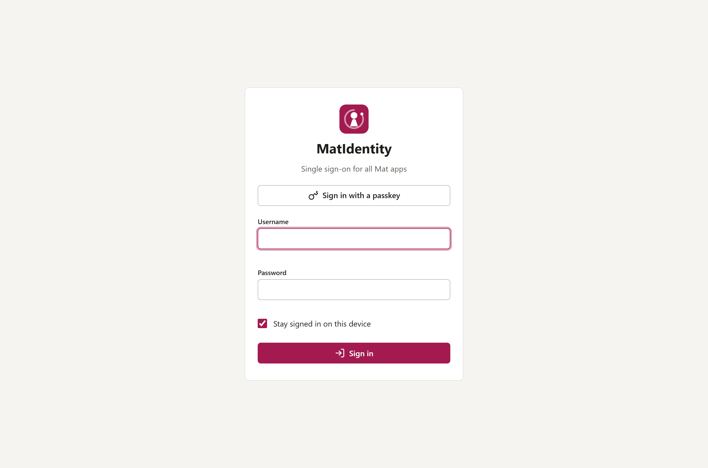 | 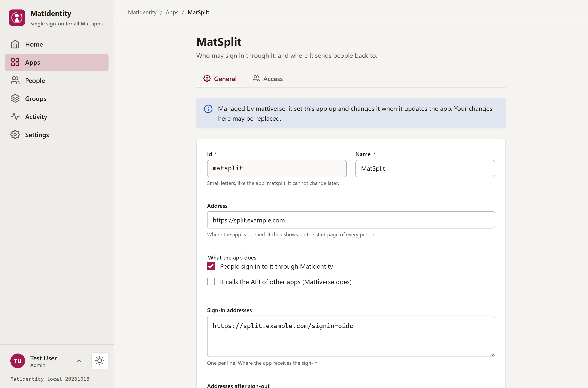 | 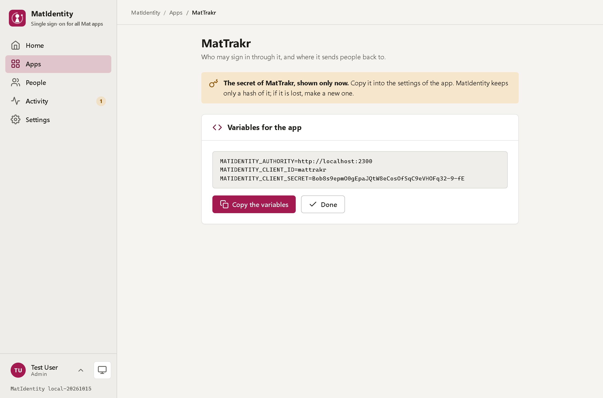 |

| Apps | People | Activity |
|---|---|---|
| 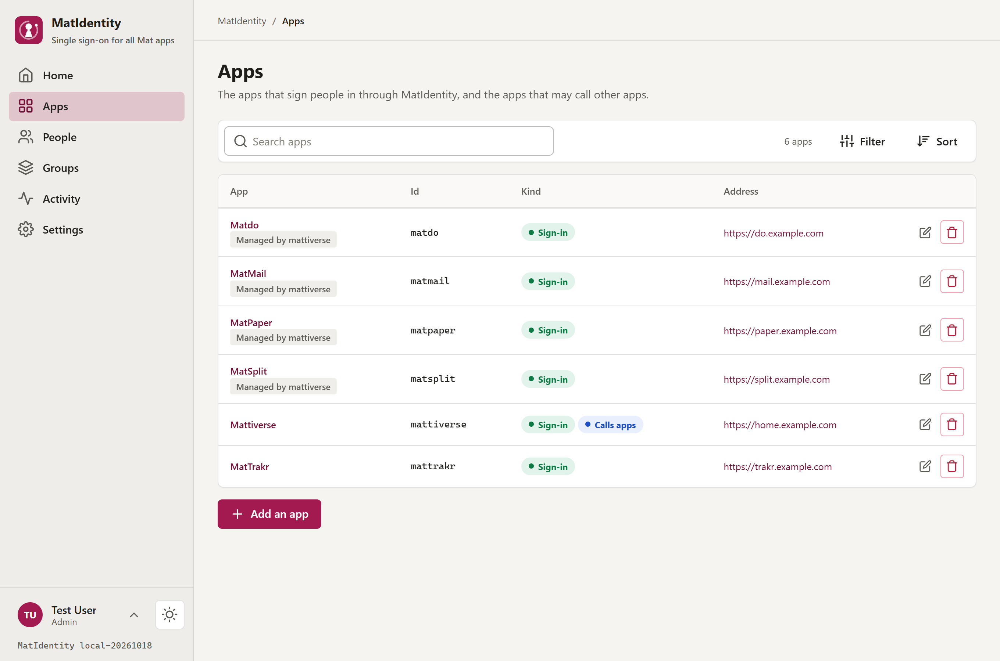 | 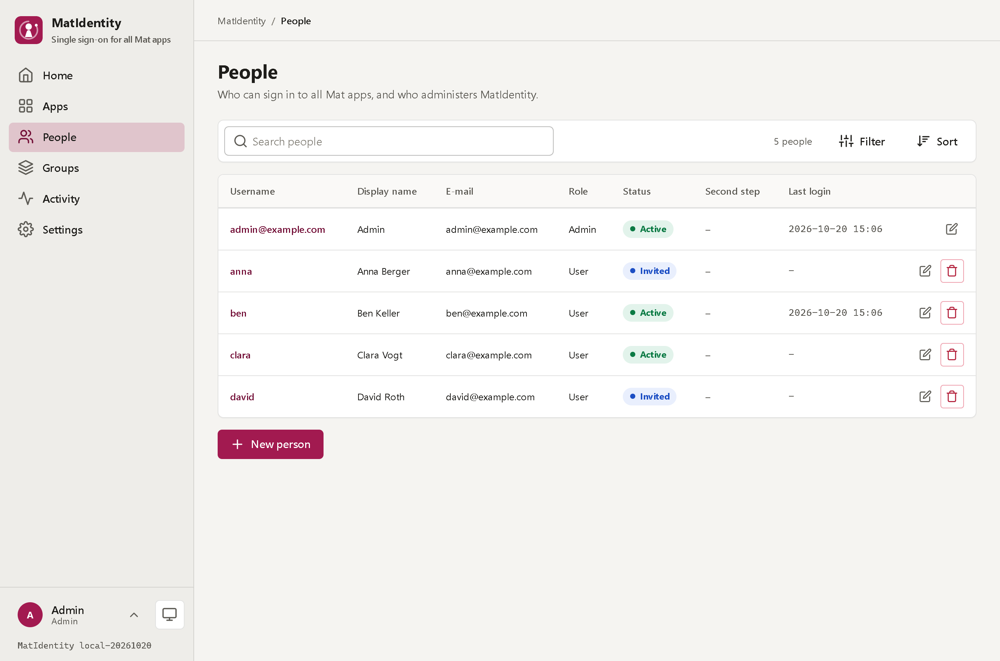 | 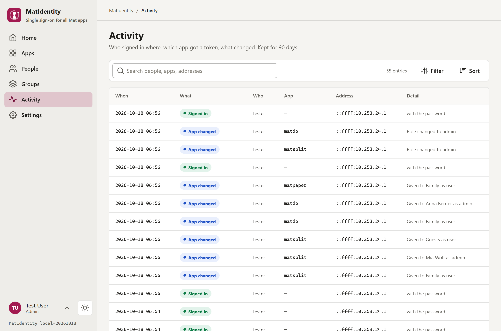 |

| Second step | Security of the account | An authenticator app |
|---|---|---|
| 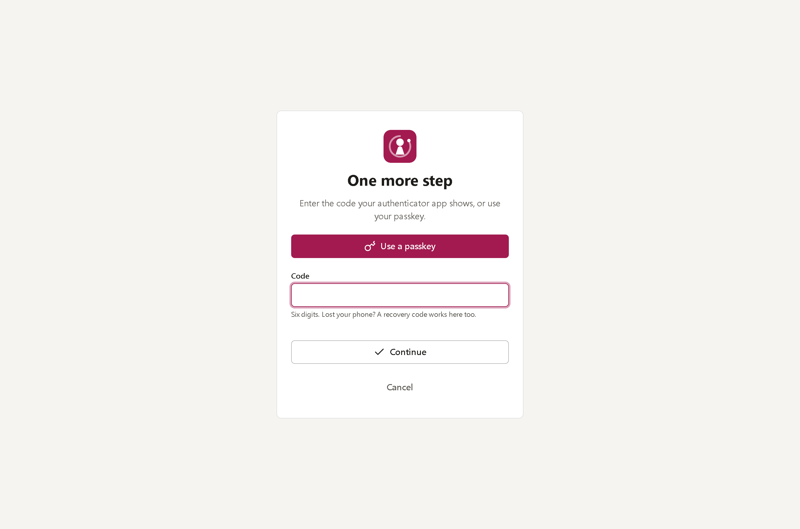 | 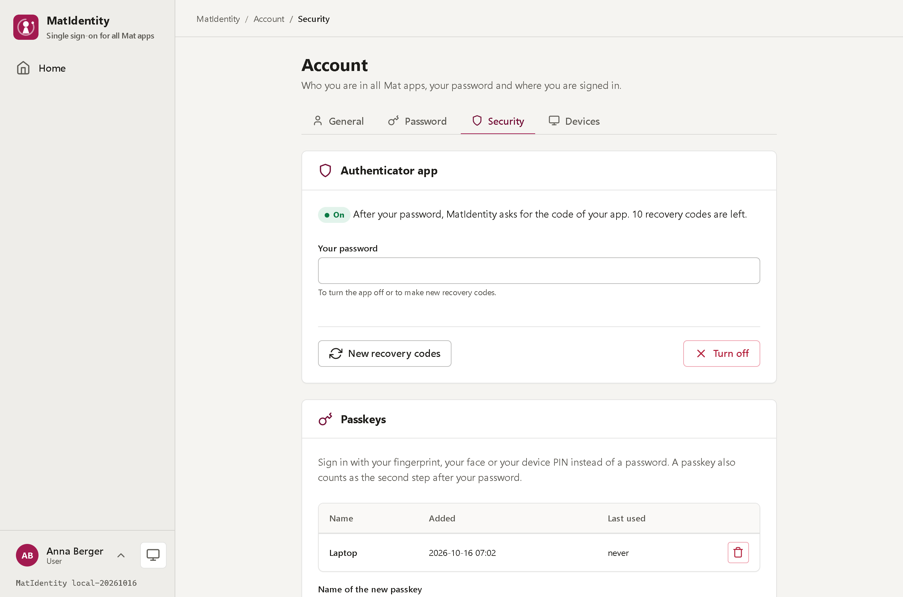 | 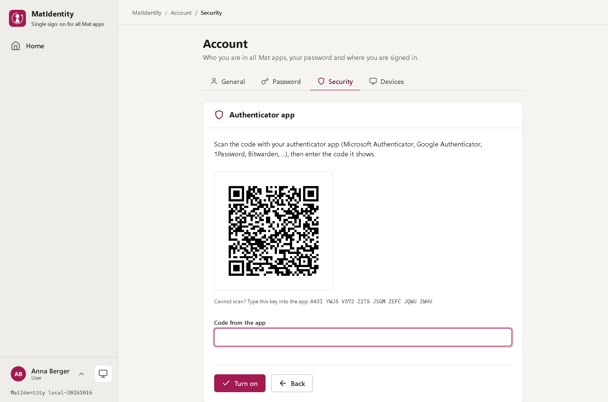 |

| Dark | Phone | Phone menu |
|---|---|---|
| 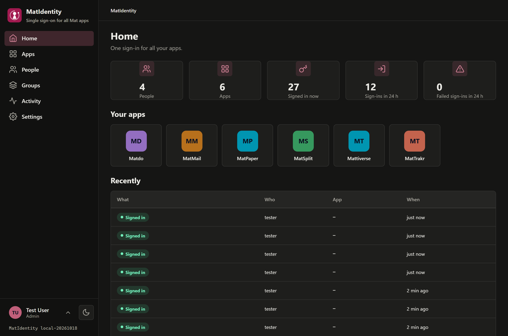 | 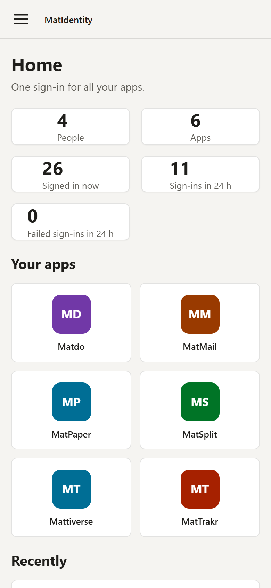 | 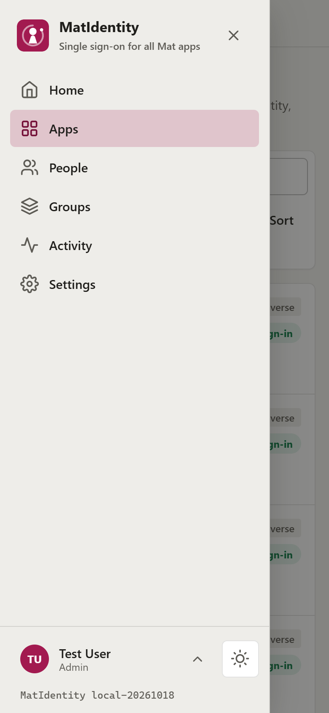 |

## Quick start

```bash
docker run -d --name matidentity --restart unless-stopped -p 2300:2300 \
  -v matidentity-data:/data \
  ghcr.io/real-ttx/matidentity:latest
```

or with Compose: [`docker-compose.yml`](docker-compose.yml). Open **http://localhost:2300**: the first start asks for the administrator.
Then put MatIdentity behind your reverse proxy with **HTTPS** (OpenID Connect needs it outside of localhost) and set its public address in *Settings*.

> **The volume holds the keys that sign every token.** Whoever has them can sign anyone in to every app: back it up like a password safe, and never share it.

### Connecting an app

In *Apps → Add an app*: the id (`matsplit`), the address and the sign-in address of the app (ASP.NET Core: `https://split.example.com/signin-oidc`).
MatIdentity shows the variables once:

```
MATIDENTITY_AUTHORITY=https://id.example.com
MATIDENTITY_CLIENT_ID=matsplit
MATIDENTITY_CLIENT_SECRET=...
```

Any other app that speaks OpenID Connect finds everything at `https://id.example.com/.well-known/openid-configuration`
(scopes `openid profile email roles offline_access`).

### Settings that matter

| Variable | Default | Meaning |
|---|---|---|
| `MatIdentity__DataPath` | `/data` | Database, settings, the keys of cookies and tokens |
| `MatIdentity__Issuer` | – | The public address (`iss`); the setting in the UI wins. Empty: the address of the request |
| `MatIdentity__TrustedProxies` | private networks | Who may send `X-Forwarded-*` (addresses or networks, comma-separated) |
| `MAT_API_KEY` | – | The key of the platform API (`X-Api-Key`); Mattiverse sets it |
| `MatIdentity__Admin__Seed` | `false` | Create the admin from `__Username` / `__Password` (headless installs; the password must be changed at the first sign-in) |
| `MATIDENTITY_PORT` | `2300` | Host port in the compose files |

## How it works

```
/data
├─ matidentity.db         SQLite: people, sessions, activity, and OpenIddict's apps, scopes, authorizations, tokens
├─ config/system.json     JSON: name, public address, how long a sign-in lasts, the lifetime of an access token
├─ dataprotection-keys/   the keys of the cookies (so sessions survive restarts)
└─ token-keys/            the RSA key that signs the tokens and the key that encrypts codes and refresh tokens
```

- [OpenIddict](https://documentation.openiddict.com/) checks the protocol; MatIdentity decides who is signed in and what goes into the tokens (`Infrastructure/OidcEndpoints.cs`).
- Access tokens are signed JWTs (not encrypted), so an app checks them itself with the published keys (`/.well-known/jwks`).
- More in [docs/ARCHITECTURE.md](docs/ARCHITECTURE.md).

## Development

Stack: ASP.NET Core 10 (Razor Pages), C#, SQLite via EF Core, OpenIddict, plain JavaScript. No Node build step.

```bash
dotnet build MatIdentity.slnx         # 0 warnings expected
dotnet test                           # unit tests and the whole site in memory: the OpenID Connect flow end to end, the API, the pages
./scripts/redeploy.ps1                # rebuild the container and redeploy the dev stack
./scripts/redeploy.ps1 -Fresh         # ... with a clean data volume (new keys: every app signs out)
./scripts/update-matui.ps1            # bring a newer MatUi from a running MatDesign into wwwroot/matui
```

The dev stack is the app plus a SQLite web viewer on `http://localhost:2309`. In `Development` the account **`tester` / `Tester123!`** exists and the
platform key is `dev-key`.

### Branches and versions

| Branch | Purpose | Image tag | Version |
|---|---|---|---|
| `main` | Release | `latest`, `release`, `<version>` | `<major>.<minor>.<build>-<yyyyMMdd>` |
| `dev` | Development | `nightly`, `<version>` | `nightly-<build>-<yyyyMMdd>` |
| local | – | – | `local-<yyyyMMdd>` |

## Status

| Area | Status |
|---|---|
| OpenID Connect server (code + PKCE, refresh, client credentials, user info, end session) | ✅ |
| People, sessions, devices, activity, sign everyone out | ✅ |
| Apps in the UI and through the API for Mattiverse | ✅ |
| The platform contract (`/api`, health, state, configure, actions) | ✅ |
| Authenticator app (TOTP), recovery codes, passkeys (passwordless and as second step) | ✅ |
| Groups, access and roles per app, which apps an app may call | ✅ |
| The apps of the family signing in through it (`MATIDENTITY_*`) | next: MatSplit first, then the others |

## License

No license file is included yet. If you intend others to reuse this, add a `LICENSE` (for example MIT) at the repo root.
